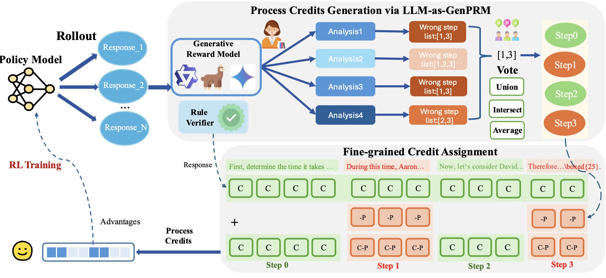
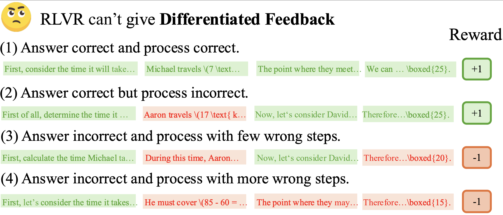

# CAPO

Official repository for the paper: **"CAPO: Towards Enhancing LLM Reasoning through Verifiable Generative Credit Assignment"**


---

## Overview

This repository contains the official implementation for **CAPO (Credit Assignment Policy Optimization)**, a novel method to enhance the reasoning abilities of Large Language Models (LLMs).



### The Challenge in RLVR: Coarse-Grained Credit Assignment



Reinforcement Learning with Verifiable Rewards (RLVR) typically assigns rewards based solely on the final outcome, failing to provide **differentiated feedback**. This lack of granular feedback hinders the model’s ability to learn robust reasoning processes. While other solutions exist, they are often inaccurate (like PPO's value estimates) or require expensive, time-consuming process supervision labels (like Process Reward Models).

### Our Solution: CAPO

CAPO introduces a simple yet powerful approach to achieve **fine-grained, verifiable credit assignment**:

1.  **Generate Step-wise Critiques:** We leverage an off-the-shelf, general-purpose LLM as a **Generative Process Reward Model (LLM-as-GenPRM)**. This LLM-as-GenPRM analyzes the entire trajectory and generates critiques for each reasoning step in a single, efficient pass.
2.  **Assign Token-Level Rewards:** These critiques are translated into verifiable, token-level rewards, refining the original, uniform reward signal.
3.  **Enhance Robustness:** To improve accuracy, we employ a voting mechanism over multiple generated critiques.

This allows the model to directly learn which parts of its reasoning to keep and which to fix.

### Experiment Results

Across challenging mathematical benchmarks and out-of-domain benchmarks, CAPO consistently outperforms SFT and other RL-based fine-tuning methods using various model backbones (Llama, Qwen). Further analysis confirms that CAPO effectively encourages the model to learn and generate correct reasoning pathways. Please refer to our paper for full experimental details.

---

## 🛠️ Installation

### 1. Environment Setup
First, create a fresh Conda environment and install the core dependencies following the `verl` installation guidelines.

```bash
# Create and activate conda environment
conda create -n verl python==3.12
conda activate verl

# Install vLLM and SGLang dependencies
SE_MEGATRON=0 bash scripts/install_vllm_sglang_mcore.sh

# Install the current package in editable mode
cd verl
pip install --no-deps -e .
```

### 2. Install Verification Tools
We use `math-verify` to enable rule-based verification for mathematical reasoning tasks.

```bash
pip install "math-verify[antlr4_9_3]==0.8.0"
```

---

## 🚀 Cluster Setup & Usage

This project utilizes a **Ray cluster** for distributed training and **vLLM** for efficient Generative PRM (Qwen-2.5-14/32B-Instruct) serving.

### Step 1: Start Ray Cluster

You need to start a Head Node and (optionally) Worker Nodes.

**On the Head Node:**
Replace `$PORT` with your desired port (e.g., `6379`).
```bash
ray start --head \
    --port=$PORT \
    --min-worker-port=20122 \
    --max-worker-port=20999
```

**On Worker Nodes (if using multi-node training):**
Connect to the head node using its IP address.
```bash
# Replace $HEAD_IP and $PORT with the actual IP and port of the Head Node
ray start --address=$HEAD_IP:$PORT \
    --min-worker-port=20122 \
    --max-worker-port=20999
```

### Step 2: Start vLLM Serving

We use vLLM to serve the Generative PRM or policy models. Run the following command on **each node** dedicated to inference (e.g., if you have 4 inference nodes).

```bash
CUDA_VISIBLE_DEVICES=0,1,2,3,4,5,6,7 nohup vllm serve \
    --config verl/recipe/prm/config_vllm.yaml \
    > /dev/null 2>&1 &
```

### Step 3: Update Configuration

After starting the vLLM services, you must manually register the node addresses.

1.  Get the IP address/URL of the nodes where you deployed vLLM.
2.  Open the file: `recipe/genrm_remote/reward_function_batch.py`.
3.  Update the address list within the file to match your deployed node endpoints.

### Step 4: Run Training Example

We provide running examples using the Qwen2.5-Math-1.5B or Qwen2.5-Math-7B model.

```bash
python3 -m recipe.prm.main_prm --config-name CAPO_Qwen1_5B
python3 -m recipe.prm.main_prm --config-name CAPO_Qwen7B
```

---

## Citation

If you find this work useful in your research, please consider citing:

```bibtex
@article{xie2025capo,
  title={CAPO: Towards Enhancing LLM Reasoning through Generative Credit Assignment},
  author={Xie, Guofu and Shi, Yunsheng and Tian, Hongtao and Yao, Ting and Zhang, Xiao},
  journal={arXiv preprint arXiv:2508.02298},
  year={2025}
}
```

## Acknowledgements

This codebase is built upon [veRL](https://github.com/volcengine/verl). We thank the authors for their open-source contribution.

## Contact

For any questions about the paper or code, please feel free to open an issue in this repository or contact [guofuxie@ruc.edu.cn].